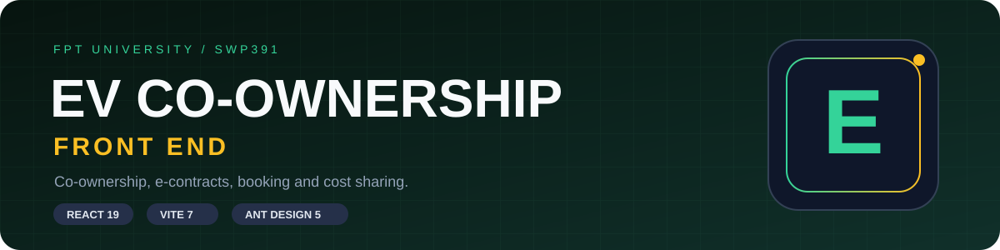
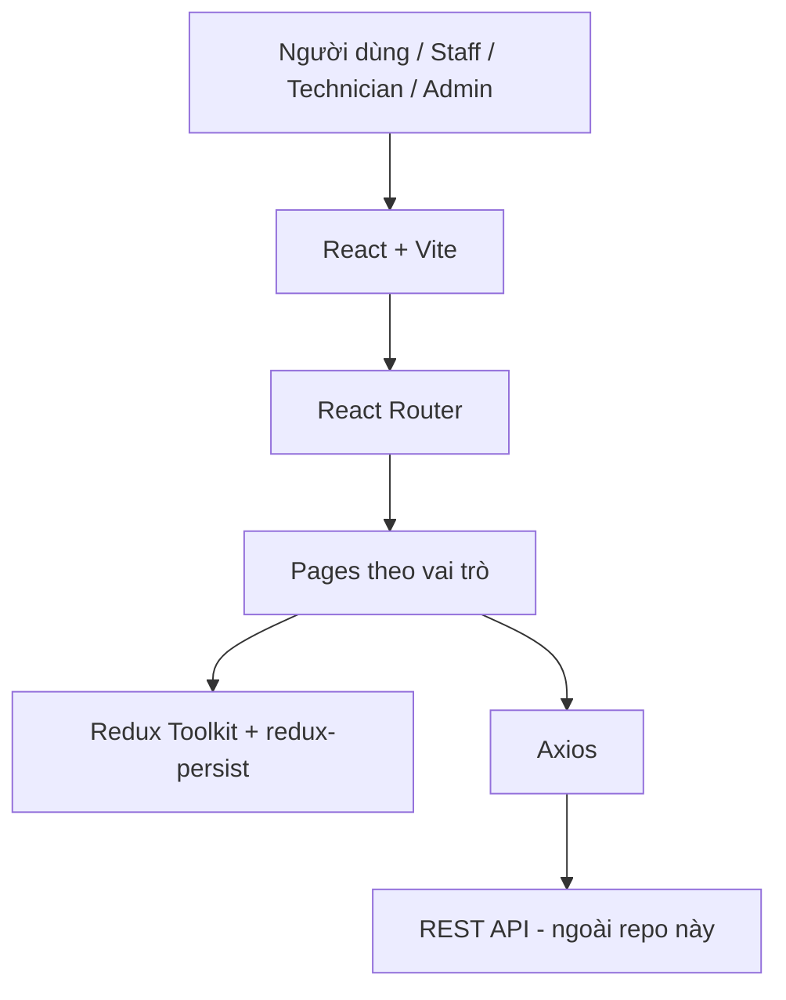

<div align="center">



# 🚗 SWP391 · EV Co-ownership and Cost-sharing

**Front end quản lý đồng sở hữu xe điện · Hợp đồng điện tử · Đặt lịch · Chia sẻ chi phí**


**[Dự án làm gì?](#-dự-án-làm-gì) · [Chức năng chính](#-chức-năng-chính) · [Cách sử dụng](#-cách-sử-dụng) · [Tech stack](#-tech-stack) · [Kiến trúc](#-kiến-trúc) · [Chạy local](#-chạy-local) · [Deployment](#-deployment)**

</div>

---

## 📖 Dự án làm gì?

Giao diện web cho hệ thống **đồng sở hữu và chia sẻ chi phí xe điện (EV)**. Nhiều người có thể cùng sở hữu một xe, ký chung hợp đồng, đặt lịch sử dụng và theo dõi chi phí, dịch vụ. Dự án được làm trong môn **SWP391** tại Đại học FPT, và là dự án React cỡ lớn đầu tiên của mình.

> Repo này **chỉ chứa front end**. REST API mà ứng dụng gọi tới **không** nằm trong repo này.

Phiên bản khai báo nằm trong [package.json](FE/SWP391_FE/package.json); phiên bản cài đặt được khóa trong [package-lock.json](FE/SWP391_FE/package-lock.json).

| 🔐 Tài khoản | 📝 Hợp đồng | 📅 Đặt lịch | 🛠️ Vận hành |
|---|---|---|---|
| Đăng ký, OTP, đăng nhập, quên/đổi mật khẩu | Tạo, duyệt, ký, xem; soạn mẫu bằng Quill | Lịch và danh sách đặt xe (FullCalendar) | Dashboard admin/staff/technician, thanh toán, dịch vụ, thông báo |

## ✨ Chức năng chính

Vai trò được phân quyền ở tầng route trong [App.jsx](FE/SWP391_FE/src/App.jsx) bằng `roleId`: `1` = admin, `2` = staff, `3` = đồng sở hữu (co-owner), `4` = technician. Trang khách (`/`, `/login`, `/register`, `/verify-otp`, `/forgot-password`, `/terms`, `/contact-us`) mở cho mọi người.

### 👤 Khách

| Chức năng | Route | Làm gì |
|---|---|---|
| Trang chủ, điều khoản, liên hệ | `/`, `/terms`, `/contact-us` | Giới thiệu hệ thống, xem điều khoản, gửi liên hệ |
| Đăng ký + xác thực OTP | `/register`, `/verify-otp` | Tạo tài khoản và xác thực bằng mã OTP |
| Đăng nhập, quên mật khẩu | `/login`, `/forgot-password` | Vào hệ thống hoặc khôi phục mật khẩu |

### 🚗 Đồng sở hữu (`roleId` 3)

| Chức năng | Route | Làm gì |
|---|---|---|
| Hồ sơ và mật khẩu | `/update-profile`, `/change-password` | Cập nhật hồ sơ, đổi mật khẩu |
| Nhóm đồng sở hữu | `/create-group`, `/view-mygroup` | Tạo nhóm, xem các nhóm của mình |
| Xe | `/view-myvehicle`, `/my-vehicle-requests` | Xem xe và theo dõi yêu cầu đăng ký xe |
| Hợp đồng điện tử | `/create-econtract`, `/view-mycontract`, `/sign-econtract/:contractId` | Tạo, xem và ký hợp đồng |
| Đặt lịch | `/booking` | Tạo và xem lượt đặt xe (lịch/danh sách, chi tiết lượt đặt) |
| Thanh toán | `/payment-history` | Xem lịch sử thanh toán |
| Dịch vụ | `/create-service-request` | Gửi yêu cầu dịch vụ cho xe |

### 🧑‍💼 Staff (`roleId` 1, 2)

| Chức năng | Route | Làm gì |
|---|---|---|
| Dashboard | `/staff/dashboard` | Trang tổng quan của staff |
| Duyệt hợp đồng | `/staff/review-econtract` | Xem xét hợp đồng điện tử |
| Duyệt yêu cầu xe | `/staff/manage-vehicle-requests` | Xử lý yêu cầu đăng ký xe |
| Quản lý đặt lịch | `/Manage.Booking` | Quản lý các lượt đặt xe |

### 🛠️ Technician (`roleId` 4; một số trang cũng mở cho admin/staff)

| Chức năng | Route | Làm gì |
|---|---|---|
| Dashboard | `/technician/dashboard` | Trang tổng quan của technician |
| Xem yêu cầu dịch vụ | `/technician/review-services` | Xem xét yêu cầu dịch vụ (admin, staff, technician) |
| Công việc dịch vụ | `/technician/service-jobs` | Danh sách công việc dịch vụ (admin, technician) |

### 🛡️ Admin (`roleId` 1)

| Chức năng | Route | Làm gì |
|---|---|---|
| Dashboard | `/admin/dashboard` | Tổng quan quản trị |
| Tài khoản | `/admin/manage-account` | Quản lý tài khoản |
| Hợp đồng | `/admin/manage-contract` | Quản lý hợp đồng (mẫu, biến, điều khoản) |
| Nhóm · Xe · Dịch vụ | `/admin/manage-group`, `/admin/manage-vehicle`, `/admin/manage-service` | Quản lý nhóm, xe, dịch vụ |
| Thống kê | `/admin/manage-statistic` | Xem thống kê (biểu đồ Recharts) |

Ngoài ra: panel thông báo trong ứng dụng, editor hợp đồng bằng Quill và xem trước HTML.

## 🧭 Cách sử dụng

Sau khi [chạy local](#-chạy-local) (và có back-end API chạy sẵn), mở địa chỉ Vite in ra ở terminal.

### Với người dùng (đồng sở hữu)

1. Vào `/register`, điền thông tin đăng ký, rồi xác thực mã OTP ở `/verify-otp`.
2. Đăng nhập ở `/login` (quên mật khẩu: `/forgot-password`).
3. Cập nhật hồ sơ ở `/update-profile` nếu cần.
4. Tạo nhóm đồng sở hữu ở `/create-group`, xem lại ở `/view-mygroup`.
5. Xem xe ở `/view-myvehicle` và theo dõi yêu cầu đăng ký xe ở `/my-vehicle-requests`.
6. Tạo hợp đồng điện tử ở `/create-econtract`, xem ở `/view-mycontract`, ký ở `/sign-econtract/:contractId`.
7. Đặt lịch dùng xe ở `/booking`.
8. Xem lịch sử thanh toán ở `/payment-history`; gửi yêu cầu dịch vụ ở `/create-service-request`.

### Với staff

1. Đăng nhập bằng tài khoản có quyền staff, vào `/staff/dashboard`.
2. Duyệt hợp đồng ở `/staff/review-econtract` và yêu cầu xe ở `/staff/manage-vehicle-requests`.
3. Quản lý lượt đặt xe ở `/Manage.Booking`.

### Với technician

1. Đăng nhập bằng tài khoản technician, vào `/technician/dashboard`.
2. Xem yêu cầu dịch vụ ở `/technician/review-services` và công việc ở `/technician/service-jobs`.

### Với admin

1. Đăng nhập bằng tài khoản admin, vào `/admin/dashboard`.
2. Dùng các trang `/admin/manage-*` để quản lý tài khoản, hợp đồng, nhóm, xe, dịch vụ và xem thống kê.

> Repo không cung cấp tài khoản demo; tài khoản và quyền do back-end quản lý. Các bước trên theo thứ tự route và phân quyền trong code; luồng chi tiết từng màn hình phụ thuộc dữ liệu từ API.

## 🧰 Tech stack

### Giao diện & routing

| Công nghệ | Phiên bản khai báo | Vai trò |
|---|---|---|
| React · React DOM | `^19.1.1` | Thư viện UI |
| Vite | `^7.1.7` | Dev server và build |
| React Router | `^7.9.3` | Điều hướng theo trang và vai trò |
| Ant Design | `^5.27.4` | Component giao diện |
| React Bootstrap · Bootstrap | `^2.10.10` · `^5.3.8` | Component và style bổ trợ |
| Tailwind CSS | `^4.1.14` | Utility CSS |

### State, form & gọi API

| Công nghệ | Phiên bản khai báo | Vai trò |
|---|---|---|
| Redux Toolkit · React Redux | `^2.9.1` · `^9.2.0` | Quản lý state |
| redux-persist | `^6.0.0` | Lưu state vào storage trình duyệt |
| Axios | `^1.12.2` | Gọi REST API |
| Formik · Yup | `^2.4.6` · `^1.7.1` | Form và validate |
| react-toastify | `^11.0.5` | Toast thông báo |

### Nghiệp vụ & hiển thị

| Thành phần | Công nghệ | Cách dùng |
|---|---|---|
| Soạn hợp đồng | Quill `^2.0.3` | Trình soạn thảo mẫu hợp đồng |
| Biến mẫu | Mustache `^4.2.0` | Điền biến vào mẫu hợp đồng |
| Lịch đặt xe | FullCalendar `^6.1.19` | Hiển thị lịch (core, daygrid, timegrid, interaction) |
| Biểu đồ | Recharts `^3.4.1` | Thống kê cho khu vực admin |
| Animation | GSAP `^3.13.0` | Hiệu ứng giao diện |
| Ngày giờ | Day.js `^1.11.18` | Xử lý ngày giờ |

### Tooling & hosting

| Nhóm | Công cụ |
|---|---|
| Lint | ESLint `^9.36.0`, eslint-plugin-react-hooks, eslint-plugin-react-refresh |
| Build | Vite + `@vitejs/plugin-react` `^5.0.4`, `babel-plugin-react-compiler` |
| Package | npm + `package-lock.json` |
| Hosting | Render Static Site ([render.yaml](render.yaml)) |

## 🏗️ Kiến trúc



Địa chỉ API được thiết lập trong [axios.js](FE/SWP391_FE/src/config/axios.js).

## 🧩 Module

| Thư mục | Phạm vi |
|---|---|
| [`FE/SWP391_FE/src/pages`](FE/SWP391_FE/src/pages) | Trang theo nhóm: `admin`, `staff`, `technician`, `booking`, `home`, `login`, `register`, `terms` |
| [`FE/SWP391_FE/src/components`](FE/SWP391_FE/src/components) | UI dùng chung: editor và preview hợp đồng, quản lý biến/điều khoản, danh sách đặt lịch, panel thông báo, sidebar theo vai trò |
| [`FE/SWP391_FE/src/components/redux`](FE/SWP391_FE/src/components/redux) | Redux store |
| [`FE/SWP391_FE/src/config`](FE/SWP391_FE/src/config) | Cấu hình Axios |
| [`FE/SWP391_FE/src/styles`](FE/SWP391_FE/src/styles) | Style chung (`theme.css`) |
| [`render.yaml`](render.yaml) | Cấu hình deploy static site trên Render |

## 🚀 Chạy local

Cần Node.js (bản LTS hiện hành) và npm. Cần thêm một back-end API đang chạy mà front end có thể truy cập; xem cách đặt địa chỉ API trong [axios.js](FE/SWP391_FE/src/config/axios.js).

```bash
cd FE/SWP391_FE
npm install
npm run dev
```

Lệnh `npm run dev` khởi động dev server.

### Biến môi trường

Repo không có file `.env.example` và không khai báo biến môi trường nào. Địa chỉ API được cấu hình trong [axios.js](FE/SWP391_FE/src/config/axios.js).

## 🧪 Lệnh development

```bash
npm run dev       # Dev server
npm run build     # Build production vào dist/
npm run lint      # ESLint
npm run preview   # Xem thử bản build
```

Chạy các lệnh trên trong thư mục `FE/SWP391_FE`.

## ☁️ Deployment

[`render.yaml`](render.yaml) định nghĩa một **Render static site**: chạy `npm install && npm run build` trong `FE/SWP391_FE` rồi publish thư mục `dist/`.

## 👥 Credits

Nhóm sinh viên Đại học FPT thực hiện cho môn SWP391. Người duy trì: [@fogit-hd](https://github.com/fogit-hd).

---

<div align="center">

**SWP391 · FPT University · Front End**

Chưa có file license; mọi quyền thuộc về nhóm tác giả.

</div>
